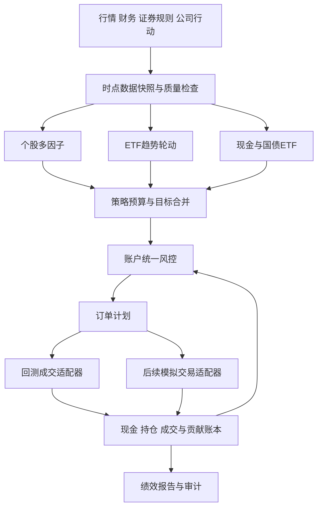

# A股与场内ETF混合策略系统设计 v0.1

设计日期：2026-10-07；2026-10-09开始独立核心实现，见[开发状态](development-status.md)。所有参数均为研究起点，尚未验证真实历史收益、回撤或可交易性。

## 1. 目标与边界

已确定：A股个股 + 场内ETF；日线决策；先确定策略思路和系统设计；最大回撤研究目标15%–20%。

初版采用三部分：个股多因子选股、ETF趋势轮动、防御仓位。研究目标是检验混合组合是否在扣除成本后，比单一策略具有更合理的收益与风险表现。不能预先认定组合一定改善回撤。

初版默认只做多、不融资、不卖空；覆盖沪深市场，北交所另行扩展。ETF仅研究二级市场买卖。盘后计算目标，下一交易日执行。个股按月调仓、ETF按周调仓、风控每日检查。

初版主动个股池先使用符合账户权限的主板普通股票；创业板、科创板可在权限和交易规则确认后扩展。ETF涉及相关板块时，仍须独立检查该ETF的交易权限和规则。

待补充但不妨碍设计：预计资金规模、已有持仓、券商与交易权限、数据预算。资金规模会影响可持有股票数量、最低佣金和订单占市场成交的比例。

## 2. 策略组合

| 模块 | 待检验的收益逻辑 | 初始资金预算 | 决策频率 | 主要风险 |
|---|---|---:|---|---|
| 个股多因子 | 价值、质量、动量与低波动特征产生选股差异 | 40% | 月度，风险检查每日 | 因子长期失效、行业偏离、财务数据时点错误 |
| ETF趋势轮动 | 持有中期趋势较强、具备流动性的资产 | 35% | 周度，风险检查每日 | 趋势反转、横盘反复换仓、与个股权益暴露重叠 |
| 防御仓位 | 通过现金和合格防御资产降低总体风险暴露 | 25% | 月度及风控事件 | 债券利率风险、ETF流动性风险、现金机会成本 |

40/35/25是固定权重研究基线，不是实盘配置建议。任何策略不足额投资时，剩余预算转为现金，不能自动加到另一风险策略。组合至少保留5%现金；所有权重均以账户净资产为分母。

多因子内部混合与资产层面的混合分开检验。价值、质量、动量、低波动可能高度相关；ETF轮动也可能只是增加同一市场风险，必须用实际收益和穿透暴露判断互补性。

## 3. 个股多因子策略

### 3.1 历史可投资股票池

每个决策日重建当时可投资的池，而不是把今天仍上市的股票用于全部历史。

- 根据当时记录排除风险警示、退市整理及不符合账户权限的证券。
- 上市满至少250个交易日，并有完整的因子所需历史。
- 以截至决策日的20日成交额和预计订单金额筛选流动性；策略交易额原则上不超过该历史平均成交额的1%。
- 暂停交易的证券不新增仓位；已有持仓继续计价并记录无法退出风险。
- 财务字段按公告可用时间取值，保留首次公告和后续更正版本。禁止把报告期末当成数据可用日。
- 金融企业和其他行业的估值、盈利字段适用性分别处理；缺少可比因子的证券不能用零值替代。

以上筛选阈值是研究设定，需结合资金规模和覆盖率检查。

### 3.2 因子与综合分数

| 因子组 | 初始候选字段 | 分数方向 | 组内注意事项 |
|---|---|---|---|
| 质量 | ROE、盈利稳定性；适用行业可加入经营现金流/资产 | 更高更好 | 负净资产、一次性收益、行业会计差异 |
| 价值 | 盈利收益率E/P、账面市值比B/P | 更高更好 | 对负盈利、负净资产规定缺失规则 |
| 动量 | 过去120日收益，跳过最近20日 | 更高更好 | 使用已发生的分红和拆分调整收益 |
| 低波动 | 过去60日收益率标准差 | 更低更好 | 不能用停牌填零制造低波动 |

初始综合分数：`score = 0.35 × quality + 0.25 × value + 0.25 × momentum + 0.15 × low_vol`。

先对原始因子去极值、处理缺失，再按当日可投资截面标准化；记录行业与规模暴露，必要时使用训练区间确定的中性化方案。各组内有效字段等权，组分数再次标准化。没有足够有效字段的证券不参与排名。

月末收盘后计算，目标持有25只股票、股票子组合内部等权；不足25只且无法满足分散约束时留现金。单只股票不超过账户净资产3%。初版使用行业配置约束，避免排名全落在同一行业。

换手缓冲研究规则：新建仓候选需进入前25；原持仓在前40且仍通过资格与风险检查时可保留。最终不足或超额时按分数补齐或移除。资格退出及组合减仓可以突破月度频率。

## 4. ETF趋势轮动策略

### 4.1 历史ETF池

初版以境内宽基和行业ETF为主要轮动资产，国债ETF用于防御。黄金ETF作为单独扩展实验；跨境ETF在交易日历、外盘信息时点和溢价数据齐备后纳入。

按历史上市日期、20日成交额、跟踪指数、资产类别与交易权限建立当时可交易池。同一指数的多个ETF优先选择当时流动性较好的产品，防止重复持仓。不能依据整个回测区间的未来成交额挑选ETF。

有至少120日有效历史才参与信号。基金合并、终止上市、分红、份额折算均保留事件记录。规模、净值等非日线字段按真实可用时间使用。

### 4.2 信号与持仓

- 趋势资格：已调整收盘价高于60日均线，且60日累计收益为正。
- 轮动分数：`0.5 × rank(20日收益) + 0.5 × rank(60日收益)`；在当时合格ETF之间计算百分位排名。
- 每周最后一个交易日收盘计算，下一个交易日调整，最多持有3只ETF。
- ETF子组合内部按过去60日波动率倒数分配，设置波动率下限，避免几乎零波动造成极大权重。
- 同一跟踪指数仅保留一只；高度重叠的行业/宽基产品在组合层合并约束。
- 不合格或持仓数量不足时，预算余量转现金，不强制选满。

初版选取上述一种排序方法。波动率调整动量、不同窗口、排名缓冲作为独立对照实验，防止同时增加多个自由参数。

## 5. 防御仓位与组合风控

初版防御仓位由现金和合格国债ETF构成。国债ETF通过流动性、数据完整性和趋势资格后，账户权重上限15%；其余防御预算保留现金。不合格时全部保留现金。债券ETF仍有价格波动，并非保本资产。

### 5.1 合并目标与风险约束

各策略输出本策略内部的目标权重（含现金），组合器乘以资金预算后按证券合并。例如个股策略内部某股票权重4%，其账户目标权重为40% × 4% = 1.6%。

| 约束 | 初版研究设定 | 实施位置 |
|---|---:|---|
| 总杠杆 | 不超过1 | 账户层 |
| 现金余额 | 至少5%，另预留费用 | 账户层 |
| 单只股票 | 不超过3%净资产 | 合并后 |
| 单只ETF | 不超过20%净资产 | 合并后 |
| 单一行业 | 个股与ETF穿透后合计不超过25%净资产 | 合并后 |
| 权益类总敞口 | 不超过80%净资产 | 合并后 |
| 国债ETF | 不超过15%净资产 | 防御层 |
| 订单容量 | 不超过截至决策日20日平均成交额的1% | 订单层 |

ETF穿透使用当时可获得的成分与权重数据，保留披露滞后。缺失时按资产分类采取保守占用并标明估计；需要行业穿透而无法建立可靠估计时，禁止新增该行业ETF。不能把“ETF”当作独立于股票的行业。

所有约束一次性施加于合并组合。初版采用可解释的同比例减仓与上限裁剪，裁剪余量回到现金；不强制满仓。实际持仓因停牌或卖单未成交超限时，记录超限并禁止进一步加大相关风险。

### 5.2 波动率控制

用截至决策日可用的60日收益估计目标风险组合的协方差与年化波动率，年化因子初始按252配置。初始目标年化波动率12%（研究参数）：

`vol_scale = min(1, 12% / estimated_annual_vol)`。

估计历史不足时不放大仓位，使用保守现金配置。股票与轮动ETF的目标权重乘以缩放系数，减出的部分转现金；防御ETF也受账户限额和独立风险检查约束。达到目标波动率不能保证最大回撤符合目标。

### 5.3 回撤状态与恢复

回撤定义为扣费后账户净值相对历史最高净值的跌幅。初始研究分级如下：

| 观察到的回撤 | 股票与轮动ETF预算系数 | 行动 |
|---|---:|---|
| 小于8% | 1.00 | 正常研究预算 |
| 8%至12% | 0.80 | 降低风险预算 |
| 12%至16% | 0.50 | 进一步减仓 |
| 16%至20% | 0.25 | 保留较小风险敞口 |
| 达到20% | 0.00 | 账户进入锁定状态，全部资产目标归零，提交可执行退出订单并记录原因 |

日线版本在收盘观察到事件后，下个可交易时点执行。隔夜跳空、跌停、停牌和滑点可能使实际回撤超过20%，阈值不能写成保证成交的止损价。

`risk_scale = min(vol_scale, drawdown_scale)`，不把两个缩放相乘重复减仓。裁剪后的现金优先留存，不自动追买防御ETF。

普通减仓等级在回撤降至触发线以下2个百分点、连续10个交易日后逐级恢复；账户历史高水位持续保留。20%锁定后包含防御ETF在内的全部资产目标归零，保持现金退出计划；实际持仓仍可能因停牌或无法成交滞留。恢复必须另建并版本化研究决策，初版不自动重置高水位或加仓。这样可防止一边处于风险退出状态、一边重新产生买单。

### 5.4 策略失效检查

策略表现与冻结的样本外预期长期偏离、数据质量下降、成本使预期收益消失时触发研究检查。初版只记录失效提示，不根据短期收益自动把全部资金转移到近期表现最好的策略。

## 6. 一次日线决策的时间顺序

1. T日收盘后等待数据完整：获取行情、证券状态、公司行动及已公开财务信息，完成校验。
2. 按信息实际可用时间建立快照；尚未发布或晚于决策截止时间的数据留到下一次。
3. 更新策略虚拟账本；遇月度/周度日期更新对应目标，其他日保留目标并执行风险退出与资格检查。
4. 合并策略目标，检查行业、权益、波动率、回撤、现金和流动性限制。
5. 使用T日价格生成股数/份额意向，并附带有效期、价格边界和资金约束；不使用T+1未来价格预先确定数量。
6. T+1交易时点执行，先处理可卖数量和卖单，再根据已确认成交及可用资金提交买单。费用预留、价格跳空可能导致减少买入量或不成交。
7. 盘后对账：现金、总持仓、可卖持仓、成交、费用、未成交订单与策略贡献。

回测模拟“已决定数量的订单在次日开盘尝试成交”，之后用实际成交价扣费和检查现金；不能用当日收盘信号在同一收盘成交。每日估值与收益包含旧持仓的隔夜变动、新持仓成交后的日内变动、分红和费用。

## 7. 交易规则与成本模型

股票ETF通常T+1；债券、黄金及部分其他ETF支持当日回转交易，不能统一设定全部ETF为T+0。[上交所ETF问答](https://www.sse.com.cn/assortment/fund/etf/question/c/c_20240118_5734755.shtml)、[深交所场内基金交易指南](https://investor.szse.cn/warning/activities/fundIntroduction/t20210104_584079.html)对此有说明。

规则按证券、交易所与生效日期管理。上交所2026年修订交易规则于2026-07-06施行，公告还列出暂缓实施条文，历史回测必须按当时有效规则执行。[上交所规则公告](https://www.sse.com.cn/lawandrules/sselawsrules2025/trade/universal/c/c_20260424_10816492.shtml)。深市规则使用[深交所交易规则入口](https://www.szse.cn/lawrules/rule/trade/current/t20260424_620190.html)，实现前逐条校验适用品种。

| 项目 | 系统设计 |
|---|---|
| 可卖数量 | 按证券与买入批次记录解锁日，不能以总持仓代替可卖数量 |
| 申报单位 | 按品种和历史规则管理买入单位、价格最小变动及零股卖出；ETF通常100份一手，具体以适用规则为准 |
| 涨跌停 | 使用历史上下限价格，不统一假设10%；触及交易限制时使用保守不成交模型 |
| 停牌与缺价 | 禁止成交；估值可沿用最近有效价格但标明陈旧，不伪造行情或低波动 |
| 成交容量 | 用T日已知流动性控制下单；日线无法复原开盘队列和盘口，报告注明近似 |
| 费用 | 佣金、最低佣金、适用税费、过户费等分项配置，按品种、买卖方向、历史日期与券商协议确定 |
| 滑点 | 买入加价、卖出减价；分别测试单边5/10/20基点假设，不当作实际市场费率 |
| 分红与复权 | 信号使用截至当时的调整收益；成交与账户记账使用原始价格和公司行动，防止重复计算分红 |
| 未成交订单 | 明确取消/到期/重发规则，次日重发必须再次核对最新目标、现金与可卖量 |

ETF费用不能机械套用股票税费。日线止损不会准确模拟盘中触发；需要盘中策略时再加入分钟数据。手续费、滑点和数据时点差异是回测与实际结果差异的重要来源，参见[QuantConnect回测与实盘对账说明](https://www.quantconnect.com/docs/v2/writing-algorithms/live-trading/reconciliation)。

## 8. 系统架构

初版采用本地单体结构，以Python处理研究与事件回测；表格式文件保存历史数据，SQLite保存运行记录和账本，配置文件保存参数。进入实现阶段再确认依赖和版本。账户订单、风险判断及记账采用同一链路，回测与模拟只替换数据和成交适配器。

| 模块 | 职责 | 核心输出 |
|---|---|---|
| data | 数据导入、质量检查、时点查询、规则版本 | 可重复的数据快照 |
| universe | 历史可投资池及排除原因 | 每日证券池 |
| factors / strategies | 因子、选股、ETF信号与防御目标 | 内部目标权重、理由、时间戳 |
| portfolio | 策略预算、相同证券合并、暴露计算 | 账户目标组合 |
| risk | 约束、回撤状态、目标裁剪 | 调整目标及拒绝原因 |
| execution | 股数转换、资金校验、订单状态、成交模拟 | 订单与成交 |
| accounting | 现金、批次、公司行动、虚拟子组合 | 对账一致的净值与贡献 |
| reporting | 绩效、基准、成本、失效和约束违例 | 可追溯研究报告 |

数据源先通过本地导入接口接入，供应商保持可替换。选择供应商前验证历史证券状态、退市数据、财务公告时点、复权事件、ETF成分及授权范围；只提供日线的接口不足以证明多因子选股回测有效。

## 9. 必须保存的数据与接口约定

| 数据对象 | 最少字段 |
|---|---|
| SecurityMaster | symbol、exchange、asset_type、list_date、delist_date、权限、规则生效区间 |
| DailyBar | trade_date、原始OHLC、volume、amount、停牌状态、涨跌停价格、available_at |
| Fundamental | symbol、字段、report_period、announced_at、available_at、value、版本 |
| CorporateAction | symbol、事件类型、除权日、到账日、份额变化、现金流 |
| Constituents | ETF/指数、成分、权重、effective_at、available_at |
| StrategyTarget | strategy_id、decision_at、snapshot_id、symbol、内部目标权重、原因 |
| RiskDecision | run_id、规则、调整前后权重、风险状态、触发原因 |
| Order / Fill | 唯一订单号、symbol、方向、数量、价格条件、有效期、状态、成交价、费用 |
| PositionLot | symbol、策略归属、数量、成本、买入时间、可卖日期 |
| RunManifest | 参数版本、数据快照、代码版本、种子、时间区间、费用规则版本 |

同一证券在不同策略中持有时，外部账户按证券净额下单；内部保留虚拟分配。内部权重转移不产生虚构外部成交或费用。实际成交、未成交和费用按预先固定规则分摊，子组合资产加共享现金必须与总账对齐。

数据异常包括缺失日期、重复行、不合理OHLC、未对齐复权事件、财务可用时间缺失。异常不能静默填补后直接交易；输出排除、冻结或失败原因。

## 10. 研究与回测验收

### 10.1 时间切分

有足够数据时使用连续时间切分：较早60%用于开发，中间20%用于方案选择，最后20%为封存样本外。按时间而非随机打乱；若历史不够覆盖多个市场阶段，明确报告证据不足。

进一步滚动验证采用过去36个月开发、随后12个月验证；仅在此前数据内选择参数。滚动验证与最终封存段分开，不能反复查看封存段后继续选模型。所有策略变体、尝试次数和选择理由都记录。

如果标签或持仓区间跨越切分边界，要留出相应隔离区间；指标预热使用此前历史且不计入测试收益。最终测试开始时是否带入持仓须固定并披露。

### 10.2 必须比较的组合

1. 可投资宽基ETF买入持有基准，现金流与费用口径一致。
2. 个股策略单独运行、ETF策略单独运行、防御模块单独运行。
3. 固定40/35/25组合，统一风险约束下的组合，以及逐一去掉模块的消融实验。
4. 匹配风险水平的静态资产组合，排除“只是少持权益”带来的表面改进。

归因同时提供：各模块独立回测、共享风控后的真实贡献、交易成本、市场与行业暴露、滚动相关性和回撤重叠。不能把独立回测收益直接按权重相加冒充实际共享账户结果。

### 10.3 评价和放行标准

- 报告扣费年化收益、最大回撤、年化波动率、夏普、卡玛、换手、费用占比、回撤恢复时间、持仓集中度和无法成交比例。
- 夏普的无风险收益采用明确数据源；没有可靠来源时标明零无风险收益假设，不能混淆口径。
- 在封存样本外检验15%–20%回撤研究目标；超过目标即记录未满足，重新研究时不得继续把原封存段当成未见数据。
- 混合组合是否改善风险调整后表现，必须结合风险匹配基准和模块贡献；若没有互补证据，减少策略数量。
- 在佣金敏感性、5/10/20基点滑点、额外延迟一天成交、参数邻域和不同市场阶段下报告结果；不只展示最好的一组。
- 核心交易约束不能违规：没有未来数据成交、没有未解锁卖出、没有负现金或超量卖出；实际持仓超限有明确处置记录。
- 分红、费用、份额变化及资产估值可对账，重复运行使用同一快照得到相同结果。
- 扣费后不具备稳健样本外证据时，不转入实盘阶段；不设未经数据支持的年化收益承诺。

## 11. 分阶段推进

| 阶段 | 交付物 | 完成条件 |
|---|---|---|
| 当前：设计 | 本文、策略规则、风险目标和待定事项 | 策略逻辑与数据需求明确，参数标为待验证 |
| 数据与单策略研究 | 时点数据样本、数据质量报告、三个独立策略报告 | 关键字段可验证，单策略可重复回测 |
| 混合回测 | 共享账本、组合约束、成本与消融报告 | 样本外和压力情景完成，账务与约束检查通过 |
| 模拟交易 | 每日目标、订单模拟、对账与异常报告 | 至少完整覆盖一次月度调仓和多次周度调仓；时间长度本身不证明有效 |
| 后续实盘设计 | 券商接口、权限、断线恢复与成交确认方案 | 研究结果满足预设标准且获得明确实盘授权 |

后续可独立比较的扩展：ETF均值回归、按市场状态调整策略预算、黄金/跨境资产、机器学习因子。每项扩展都要有新增互补性证据和独立样本外验证。

## 12. 本次设计的状态

设计阶段已完成策略规则、组合与风控、交易时序、数据模型、系统模块、回测验收和分阶段路线设计，并检查本地行情。2026-10-09已开始在`Stock`独立实现策略与模拟执行核心；合成演示只作工程验证，尚未进行真实数据绩效回测或接入券商。

下一步研究优先级：先确认资金规模与数据条件，再验证个股因子的历史可用性和ETF池；用固定组合建立可对账基线，之后检验风控和动态配置是否提供额外价值。

## 13. 本地数据接入补充（2026-10-07）

用户提供数据位于`D:\vscode\data\A股数据\parquet`，来源项目为`D:\vscode\AlphaMaster`。已读取全部17,951个文件的元数据，全量检查4,487个日线文件并抽查60个分钟文件，详见[数据检查与接入评估](local-data-assessment.md)。

- 有4,272个股票日线文件，基础OHLC检查通过；候选时间解码下历史最晚为2026-07-07，编码、时区和复权尚需核验。
- 指数数据严重异常，先整体隔离；分钟线有时间精度损失，不能用去重替代修复。
- 未发现ETF行情、财务公告时点、公司行动、历史证券状态、历史行业及成交额；不能直接运行本文完整策略并声称回测有效。
- 接入采用只读源目录和版本化规范化输出，禁止自动猜测时间/单位后静默交易。

策略方向保持不变，研究先后顺序改为数据修复与补齐、股票价格因子基线、完整多因子和ETF模块、混合组合验证。价格因子基线不代表已实现质量和价值选股。

后续已建立参考比对、股票日线规范化、ETF与财务公开快照接入及回测准入保护，见[数据准备进度](data-preparation-progress.md)。规范化数据仍须补齐公司行动、历史状态和历史财务版本后才可进入正式策略回测。

2026-10-09已扩展股票池分红送转采集并完成全量财务字段审计。公司行动数据要分别保留普通账户现金、除息参考价口径、日终实施与下一交易阶段、股利应收与支付日期。510500拆分按原公告记录1.14539及日终实施，明确持有人份额取整；未确认的价格调整交易日不以表格日期代填。财务因子需处理扣非ROE等字段大量缺失、负利润和TTM依赖，缺失不得填零参加排名，当前修订快照不能回填历史公告日。策略参数尚未进入绩效评价阶段。

后续补齐上交所计划日历并接入部分官方挂牌与简称记录。交叉审计发现：在2018-01-01至2026-07-07窗口内，已取得来源中的236个退市A股代码有232个缺本地价格。当前本地股票池不能作为完整历史可投资池；原先价格因子基线也须先解决历史池、停复牌和公司行动，避免将接口覆盖差异混入因子表现。退市日、名称前缀和当前行业/股本均不能直接变成历史成交资格或因子输入。补采验收要求见[退市行情清单](../reports/missing-retired-prices.md)，未解决的范围继续在运行清单中明确记录。
