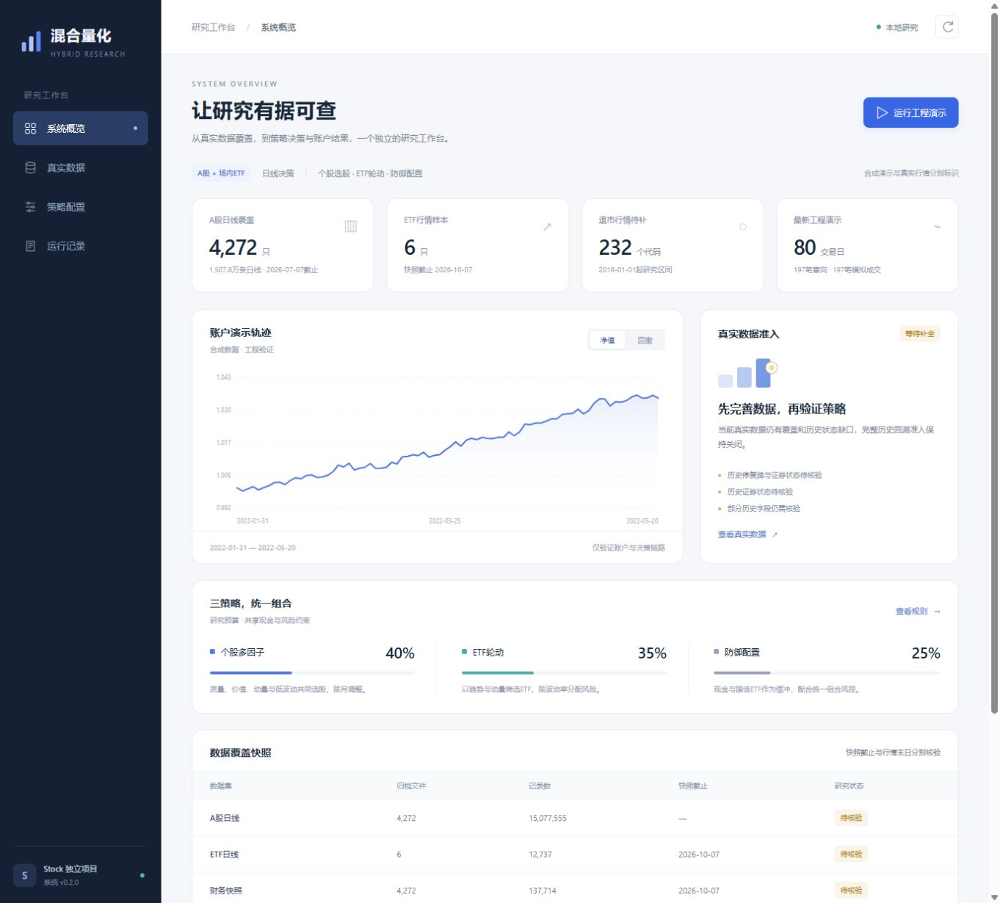

# v0.2.0本地研究工作台验证

验证日期：2026-10-09。独立项目`D:\vscode\Stock`，服务地址`http://127.0.0.1:8765`。详细数据及本轮源文件哈希见[validation.json](validation.json)。

## 自动检查

全套121项检查通过，覆盖原有数据接入、策略、组合风控、账户及输入契约；新增20项检查验证只读行情适配、归档哈希/路径/类型/非有限值、缺失证据处理、HTTP路由、同源演示操作及重复运行锁。界面修改后再次执行这20项检查，全部通过；`node --check hybrid_quant/web/app.js`通过。

## 浏览器验证

| 操作 | 结果 |
|---|---|
| 系统概览 | 显示v0.2.0、6类注册数据和真实回测待补全状态 |
| 净值/回撤切换 | 合成账户图表与选中状态同步切换 |
| 股票搜索000001 | 1个匹配；200条预览日线，末日2026-07-07，复权/交易状态显示待核验/未知 |
| ETF搜索510300 | 匹配sh510300；末日2026-09-30，K线与日线表显示正确 |
| 搜索999999及跨数据集查询 | 0匹配，旧行情和旧审计内容清空；重新搜索恢复 |
| 策略配置 | 只读展示40/35/25预算、组合风险与明确标注的模拟费用 |
| 工程演示按钮 | 运行中禁用，完成后显示新归档和80日/197笔模拟成交 |
| 订单分页 | 从第1–30条切换至第31–60条，共197条 |
| 策略决策日志 | 80条记录，风险缩放、回撤与决策详情可查看 |
| 空分红日志 | 显示0条，两侧翻页按钮禁用 |
| 390像素宽度 | 页面无横向溢出，4个导航仍有可访问名称，预算条比例为40/35/25；临时宽度设置已恢复 |
| 浏览器控制台 | 本轮未发现错误或警告 |

验证中修正了搜索无结果残留旧行情、窄屏预算条最低宽度、导航缺少名称及退市研究窗口日期读取问题。数据状态只由实际准入结果显示，清单自行声明就绪不能使页面显示已准入。

## 归档与真实数据状态

工作台生成的[20261009T112157Z_f0a9deb7报告](../demo/20261009T112157Z_f0a9deb7/report.md)共80个合成交易日、197笔订单意向及197笔模拟成交；8个输出文件SHA-256均通过核验，保存的Python代码哈希与当前文件一致。原v0.1.0归档独立保留，其他已生成记录也通过输出哈希校验。

真实数据准入仍为`blocked`：4,272只本地股票行情末日为2026-07-07，已取得来源中的研究窗口退市候选236个代码有232个缺行情。财务原始历史版本、证券状态、公司行动和历史交易规则等证据仍待补齐。工作台可运行不代表真实历史回测可运行。

合成证券、行情、费用与账户值用于验证程序，不作为投资业绩。本轮没有连接券商或执行实盘交易；历史快照的结构校验不提供缺失历史证据。

